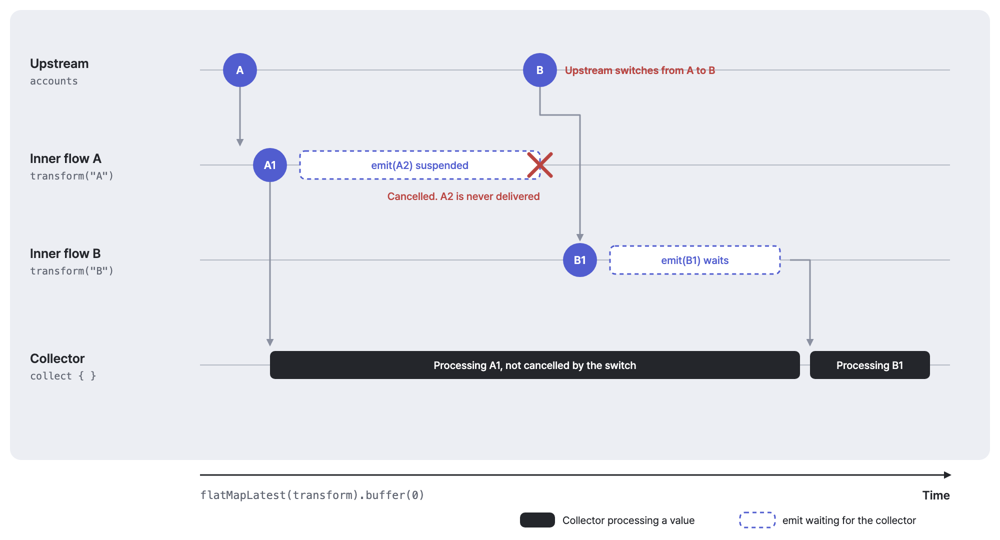

# LifeMash Coroutines

Android와 서버에서 사용하는 Kotlin/JVM 코루틴 확장 라이브러리입니다. 제품 모델과 Android API에 의존하지 않습니다. 지금은 출력 버퍼 없이 구독을 전환하는 `flatMapLatestUnbuffered` 하나를 제공합니다.



가로축은 시간입니다. 상위 값이 A에서 B로 바뀌면 내부 Flow A의 구독을 취소하고, 소비자가 아직 받지 않은 A2는 전달하지 않습니다. 소비자가 처리 중인 A1은 취소하지 않으며, B1은 소비자가 A1 처리를 마칠 때까지 기다렸다가 전달됩니다.

## 사용

계정처럼 상위 값이 바뀌면 이전 구독을 버리고, 출력 결과를 쌓아둘 필요가 없는 구독 전환에 사용합니다.

```kotlin
import com.lifemash.coroutines.flatMapLatestUnbuffered

val calendar = accountFlow.flatMapLatestUnbuffered { account ->
    repository.observeCalendar(account.id)
}
```

구현은 `flatMapLatest(transform).buffer(0)`입니다. 동작은 다음과 같습니다.

- **구독 전환**<br>상위 값이 바뀌면 이전 내부 구독을 취소하고 새 구독으로 전환합니다
- **출력 버퍼 0**<br>소비자가 다음 값을 받을 때까지 emit이 일시 중단됩니다
- **이미 전달한 값**<br>그 값의 처리 완료를 기다리거나 처리를 취소하지 않습니다
- **`conflate()`와 차이**<br>`conflate()`는 같은 내부 Flow의 중간 값을 버립니다. 이 함수는 같은 내부 Flow의 값을 버리지 않습니다
- **연산자 결합**<br>뒤에 붙인 `buffer`, `conflate` 등은 출력 전달 동작을 바꿀 수 있습니다

모든 `flatMapLatest`를 대체하거나 계정 격리를 보장하는 API가 아닙니다.

## 의존성

GitHub Packages에서 받으며, 읽기 자격은 저장소 파일에 작성하지 않습니다.

```kotlin
implementation("com.lifemash:lifemash-coroutines:0.1.0")
```

Gradle 저장소 설정에 다음을 추가합니다.

```kotlin
maven {
    name = "LifeMashPackages"
    url = uri("https://maven.pkg.github.com/lifemash-hq/lifemash-coroutines")
    credentials {
        username = providers.gradleProperty("lifemashPackagesUser")
            .orElse(providers.environmentVariable("LIFEMASH_PACKAGES_USER")).orNull
        password = providers.gradleProperty("lifemashPackagesToken")
            .orElse(providers.environmentVariable("LIFEMASH_PACKAGES_TOKEN")).orNull
    }
    content {
        includeModule("com.lifemash", "lifemash-coroutines")
    }
}
```

로컬은 사용자 Gradle 설정 또는 환경 변수로 읽기 자격을 제공합니다. GitHub Packages 공식 문서는 `read:packages` 권한의 PAT(classic)을 안내합니다. 소비 저장소의 CI는 해당 패키지 접근 권한을 갖춘 자격이 필요하며, 다른 저장소의 기본 GITHUB_TOKEN에 접근 권한이 있다고 가정하지 않습니다.

## 빌드와 검증

JDK 21에서 `./gradlew check assemble`을 실행합니다.

| 항목 | 버전 |
| --- | --- |
| 빌드 JDK | 21 |
| JVM 바이트코드 대상 | 17 |
| Kotlin | 2.3.0 |
| kotlinx.coroutines | 1.10.1 |

현재 Android 프로젝트와 같은 기준입니다. Kotlin/Native, Kotlin/JS와 더 낮은 Kotlin 컴파일러 호환성은 지원 검증 범위가 아닙니다.

테스트는 느린 소비자의 역압, 상위 값 변경 시 대기 중 방출 취소, 소비자 취소의 전파와 내부 예외를 확인합니다. 실행 코루틴의 취소 협조 규칙은 kotlinx.coroutines를 따릅니다.

## 릴리스

버전 태그를 게시하면 Publish workflow가 GitHub Packages에 올립니다. 이미 게시한 버전은 덮어쓰지 않습니다.

1. `gradle.properties`의 버전과 [변경 기록](CHANGELOG.md)을 갱신합니다
2. `./gradlew check assemble generatePomFileForLibraryPublication`으로 검증합니다
3. main에 반영한 커밋에 `v0.1.0`처럼 프로젝트 버전과 같은 태그를 게시합니다
4. Publish workflow가 검증을 다시 실행한 뒤 같은 저장소의 GITHUB_TOKEN으로 GitHub Packages에 게시합니다
5. 배포 버전을 실제 소비 프로젝트에서 내려받아 빌드합니다

문제가 있으면 소비 프로젝트의 의존성을 이전에 검증한 버전으로 되돌리고 수정 버전을 발행합니다. 최초 버전에 문제가 있으면 도입 전 구현으로 되돌립니다.

## 참고

- [flatMapLatest](https://kotlinlang.org/api/kotlinx.coroutines/kotlinx-coroutines-core/kotlinx.coroutines.flow/flat-map-latest.html)
- [buffer와 연산자 결합](https://kotlinlang.org/api/kotlinx.coroutines/kotlinx-coroutines-core/kotlinx.coroutines.flow/buffer.html)
- [GitHub Gradle 레지스트리](https://docs.github.com/en/packages/working-with-a-github-packages-registry/working-with-the-gradle-registry)
